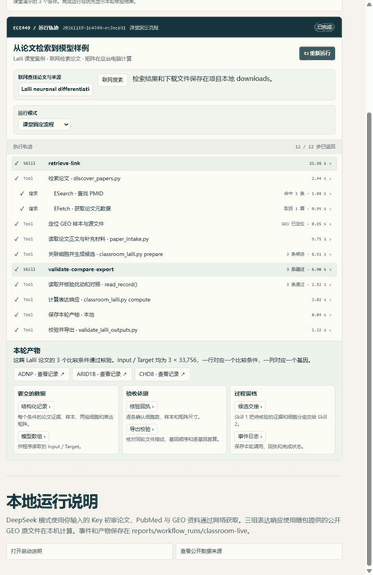

# bio-perturbknowledge

ECE449 课堂运行台。从检索公开论文开始，展示双 Skill、工具执行轨迹和扰动表达数据导出。

## Windows 一键启动

在 PowerShell 中粘贴：

```powershell
git clone --depth 1 https://github.com/MHQQysh/bio-perturbknowledge.git
cd bio-perturbknowledge
.\Start-ECE449.cmd
```

启动器会自动准备 Python 与依赖，并打开 [本机运行台](http://127.0.0.1:8895/#classroom-demo)。首次准备环境和原始数据需要联网，原始数据约 26 MB。后续可复用已下载的数据。保持启动窗口打开。

如果网络阻断 `git clone`，可直接[下载 GitHub 源码 ZIP](https://github.com/MHQQysh/bio-perturbknowledge/archive/refs/heads/main.zip)，完整解压后双击 `Start-ECE449.cmd`。若手头已有包含运行时和 GEO 数据的 Windows 便携包，也可直接解压启动该包。

在页面选择 **DeepSeek API**，粘贴你的 Key，点击 **启动演示**。只想走一遍流程时可选 **课堂固定流程**。矩阵计算在本机进行，无需 SSH 或 Codex。

## 实跑录屏



录屏使用课堂固定流程。两项 Skill 依次建立候选证据包、核验细胞与对照、计算响应并导出结果。也可以在页面选 Lalli、Jost 或 Replogle 做单条抽查。

## 本轮文件

每轮结果单独写入 `reports/workflow_runs/classroom-live/`。结构化记录与 Input / Target 是数据产物，核验回执和导出校验用于验收，候选交接与事件日志用于复查流程。

公开运行案例来源于 [Lalli 论文](https://pmc.ncbi.nlm.nih.gov/articles/PMC7545139/) 和 [GEO GSM4219576](https://www.ncbi.nlm.nih.gov/geo/query/acc.cgi?acc=GSM4219576)。DeepSeek 初审使用公开论文元数据和样本信息，API Key 只在当轮调用中使用。
